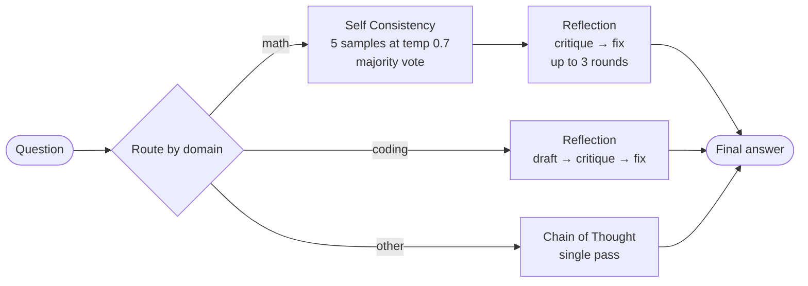

# LLM Reasoning Agent

An inference time agent that makes a language model better at math and coding questions without retraining it. Instead of trusting one answer, the agent samples several solutions, votes on the most common one, then has the model critique and fix its own work.

Built as my final project for CSE 476 at Arizona State University.

## The Problem

A single pass from a language model often gets multi step math wrong: it drops a constraint, keeps an extraneous root, or makes one arithmetic slip that ruins the answer. The project limit was 20 model calls per question, so the goal was to spend those calls in a smarter way to get more reliable answers from the same model.

## How It Works



1. **Route.** The agent uses the question's domain label, or guesses it from keywords if the label is missing.
2. **Explore (math).** It generates 5 step by step solutions at higher temperature, pulls the final answer out of each (`\boxed{}` first, then `Answer:`), and keeps the answer that appears most often.
3. **Verify.** The winning solution goes to a strict reviewer prompt that checks for extraneous roots and broken constraints. If the reviewer says it is correct, the agent stops early. If not, it asks for a fix and checks again, up to 3 times.

A math question uses about 6 to 8 calls, well under the 20 call limit.

## Features

- Three inference strategies: Chain of Thought, Self Consistency (majority vote) and Reflection (self correction)
- A composite strategy that chains Self Consistency into Reflection for math
- Domain specific prompts for math and coding
- Early stopping when the critique confirms the answer, to save calls
- Automatic retries for failed API calls
- Batch scripts that save progress on Ctrl+C, and a full test set runner that resumes where it left off
- An evaluator that grades against the dev set with numeric tolerance and a per domain breakdown

## Key Decisions

- **Vote first, then verify.** Voting fixes random slips, and reflection catches the systematic mistakes that voting can't (when most samples are wrong the same way). Running them in that order means reflection starts from the strongest candidate.
- **Vote on the extracted answer, not the full text.** Two solutions can reason differently and still agree. The agent normalizes the final answer before counting votes, then returns the full reasoning of the winner.
- **Stop early when the critique passes.** Most correct answers need only one review call, which keeps the average well below the call limit.
- **Saving progress during long runs.** The full test set takes a long time to run, so the runner saves what it has on Ctrl+C and skips already answered questions when you start it again.

## Results

- Generated answers for all 2,287 questions in the course test set, all within the 20 call per question limit
- More details on the strategies and evaluation are in [report.md](report.md)

## Tech Stack

Python, `requests`, `tqdm`, and any OpenAI compatible chat completions API.

## Project Layout

```
src/
  agent.py        Routes each question to a strategy
  strategies.py   Chain of Thought, Self Consistency, Reflection, composite strategy
  client.py       API client with retries
  evaluator.py    Grades predictions on the dev set
generate_submission.py        Runs the full test set (resumable)
generate_test_predictions.py  Runs a sample of the test set
generate_outputs.py           Runs the dev set
verify_format.py              Checks the answers file matches the grader format
report.md                     Project report
```

## Run It Locally

You need Python 3.9 or newer and access to an OpenAI compatible endpoint.

```bash
git clone https://github.com/manaswichowdary/CSE476.git
cd CSE476
pip install -r requirements.txt

export API_BASE=http://your-server:port/v1
export OPENAI_API_KEY=your_key_here
export MODEL_NAME=your_model
```

Try it on one question:

```bash
python3 -c "from src.agent import Agent; print(Agent().solve({'input': 'What is 17 * 23?', 'domain': 'math'}))"
```

The course dev and test data files are not included in this repo. If you have them, put them in the paths listed in `.gitignore`, then run:

```bash
python3 -m src.evaluator --limit 10      # grade 10 dev questions
python3 generate_submission.py           # answer the full test set
python3 verify_format.py                 # check the output format
```
